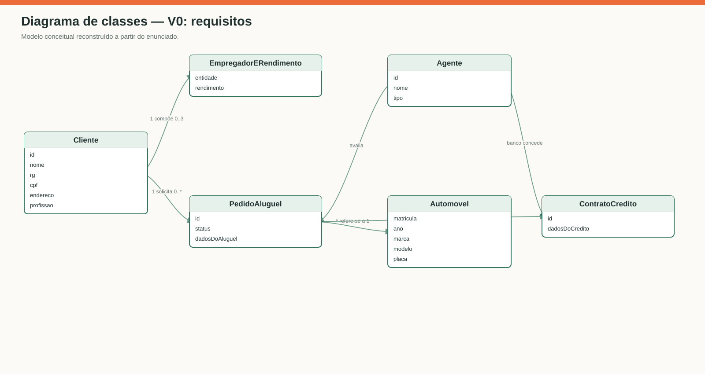
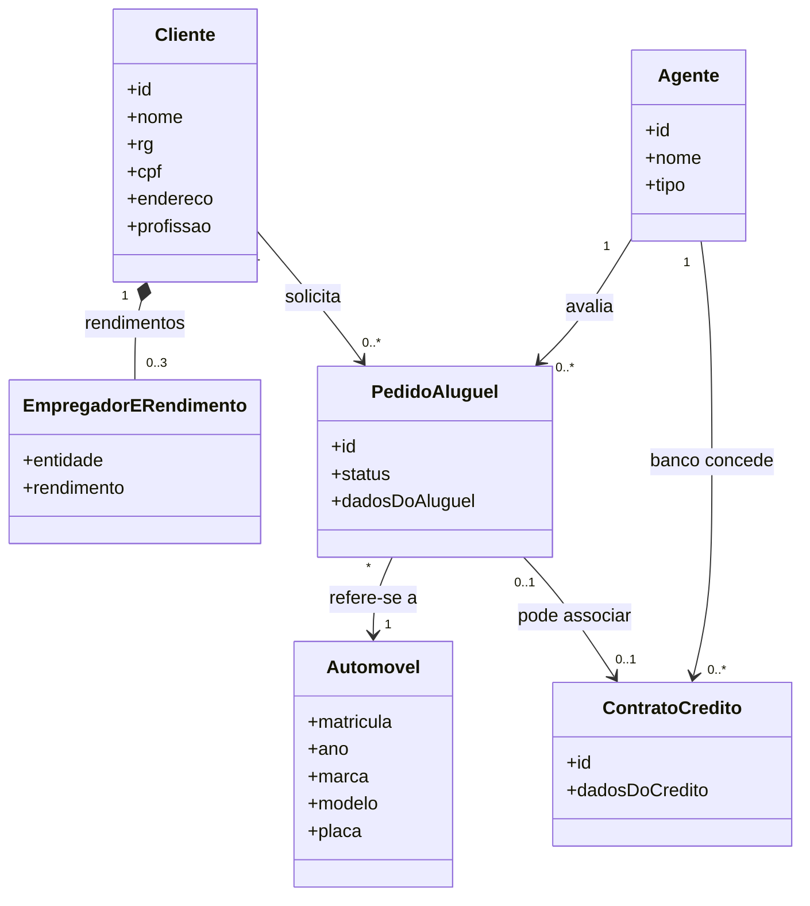
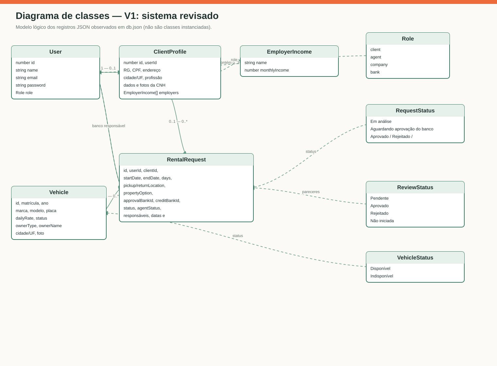
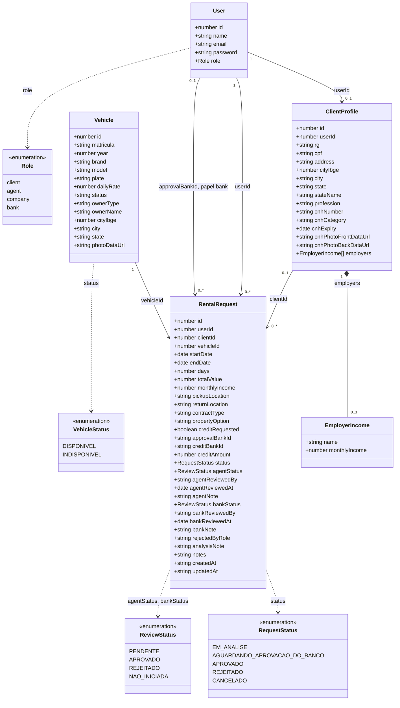

# Diagrama de classes

## V0 — modelo conceitual dos requisitos

Fonte Mermaid da imagem

## V1 — modelo lógico dos registros implementados

Fonte Mermaid da imagem

### Revisão V0 → V1

- Separadas a conta (`User`) e os dados cadastrais (`ClientProfile`), que são
  registros independentes nas coleções `users` e `clients`, ligados por
  `userId`.
- Rendimentos continuam limitados a três, mas são objetos embutidos em
  `ClientProfile.employers`; não possuem identidade ou endpoint próprio. O
  perfil pode existir sem rendimentos enquanto está incompleto.
- Automóveis foram modelados como `Vehicle`, com os campos implementados para
  catálogo, disponibilidade, propriedade e foto.
- Pedido agora explicita período, cálculo do total, localidades, preferência
  de contrato/propriedade, banco responsável e campos das duas decisões.
- O banco é referenciado por `approvalBankId` para um usuário de papel `bank`;
  crédito opcional usa campos no próprio pedido, não uma entidade persistida
  `ContratoCredito`.

### Observações sobre persistência

O diagrama representa a forma lógica dos documentos JSON, não validações
relacionais do banco. JSON Server não impõe chaves estrangeiras, cardinalidades
ou enumerações. A propriedade `password` aparece porque existe nos dados de
demonstração; o armazenamento de senha em texto simples não é apropriado para
um sistema real. Os valores de `RequestStatus` correspondem a `Em análise`,
`Aguardando aprovação do banco`, `Aprovado`, `Rejeitado` e `Cancelado`;
`ReviewStatus` corresponde a `Pendente`, `Aprovado`, `Rejeitado` e
`Não iniciada`; `VehicleStatus` corresponde a `Disponível` e `Indisponível`.
O identificador do banco é string no formulário JSON atual, e os horários de
auditoria são armazenados como strings ISO 8601.
