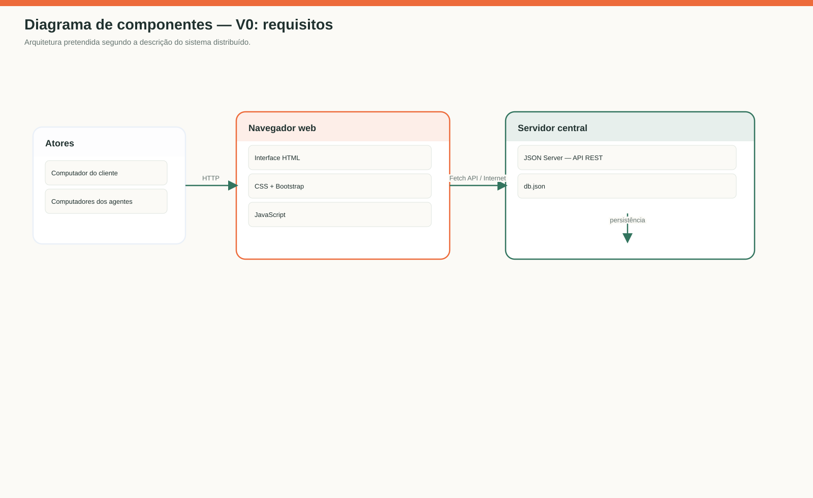
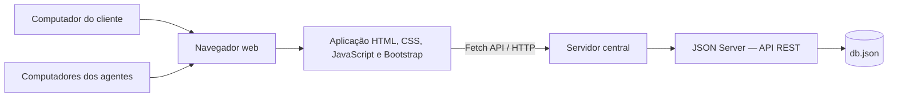
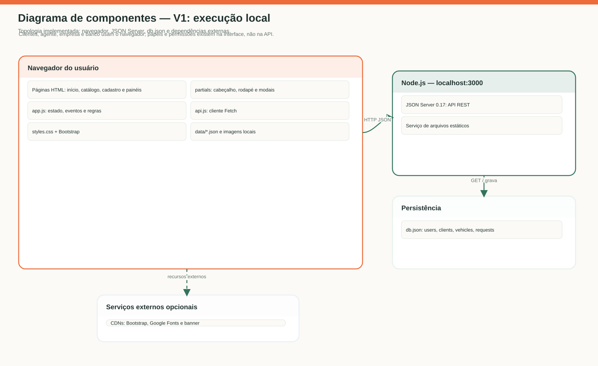
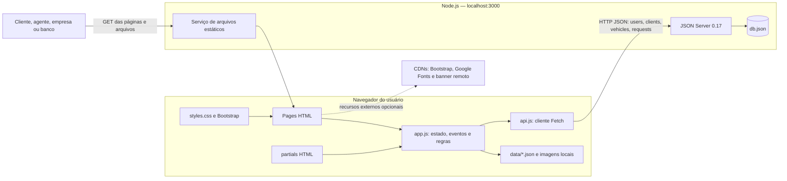

# Diagrama de componentes

## V0 — arquitetura pretendida no enunciado

Fonte Mermaid da imagem

## V1 — componentes e conexões da implementação

Fonte Mermaid da imagem

### Revisão V0 → V1

- Substituído o servidor central genérico pela topologia executável: navegador,
  processo Node/JSON Server na porta 3000, arquivos estáticos e `db.json`.
- Mostrada a separação entre `app.js` e `api.js`, além dos dados JSON locais.
- Registradas as dependências externas de Bootstrap, Google Fonts e imagem do
  banner; a API e as fotos locais não dependem dessas CDNs.
- A comunicação é uma simulação local da arquitetura distribuída descrita no
  enunciado; não existe servidor remoto implantado no repositório.

## Correspondência com o código

| Componente | Arquivos |
| --- | --- |
| Páginas da interface | `index.html`, `veiculos.html`, `cadastro.html`, `solicitar.html`, `pedidos.html`, `analise.html`, `clientes.html`, `frota.html` |
| Componentes compartilhados | `partials/header.html`, `partials/footer.html`, `partials/modals.html` |
| Lógica da aplicação | `app.js` |
| Comunicação HTTP | `api.js` |
| Estilos e framework visual | `styles.css` e Bootstrap 5 via CDN |
| API e persistência de demonstração | JSON Server e `db.json` |
| Dados locais de catálogo | `data/municipalities.json`, `data/brazilian-cars.json`, `data/vehicle-photos.json`, `images/` |
