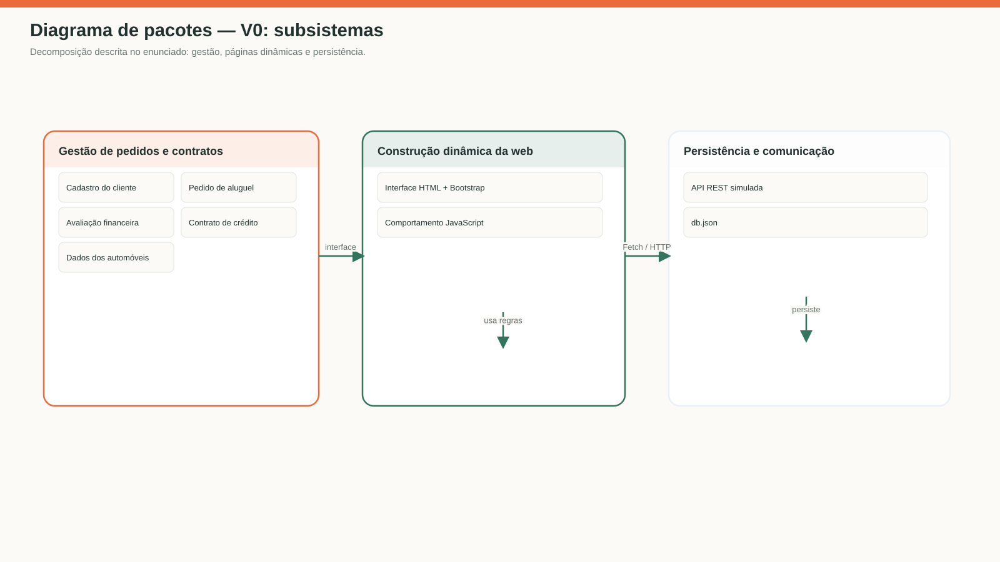
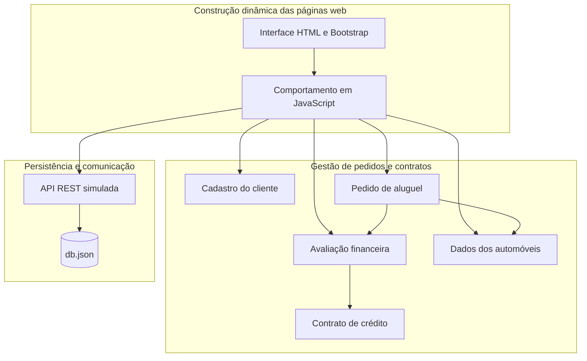
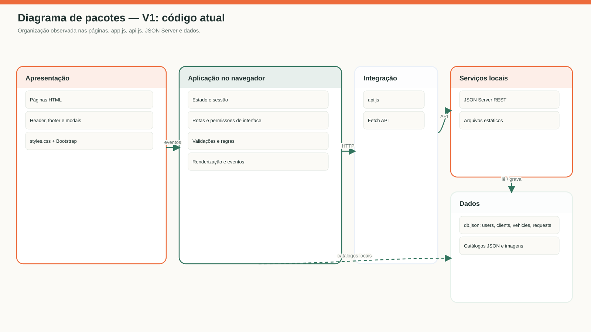
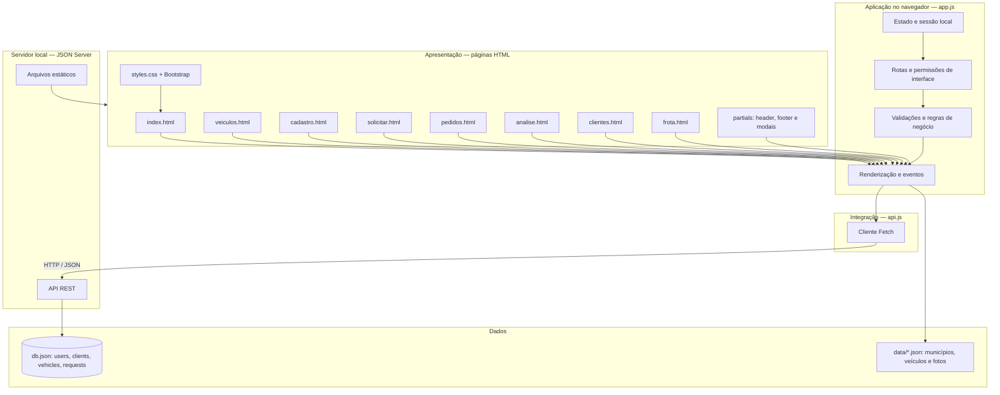

# Diagrama de pacotes — visão lógica

## V0 — decomposição dos subsistemas do enunciado

Fonte Mermaid da imagem

## V1 — pacotes observados no repositório

Fonte Mermaid da imagem

### Revisão V0 → V1

- Detalhada a divisão efetiva: páginas/partials e estilos, lógica compartilhada
  no navegador, cliente Fetch, servidor e arquivos de dados.
- Registrado que as telas são arquivos HTML separados; a aplicação não possui
  um framework de interface nem pacotes de domínio JavaScript independentes.
- Incluídas as coleções reais do `db.json` e os catálogos JSON lidos pelo
  navegador.
- A autorização representada em `app.js` protege a navegação da interface, mas
  não corresponde a um pacote de autenticação no servidor.
